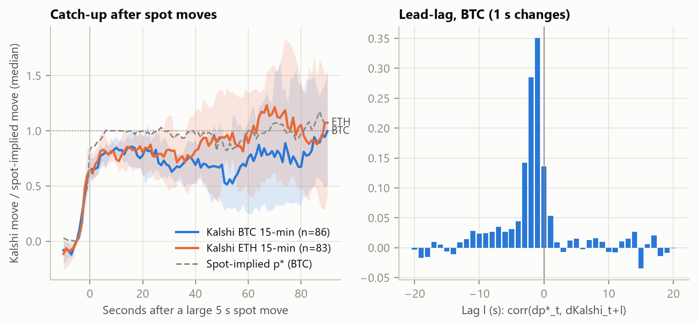
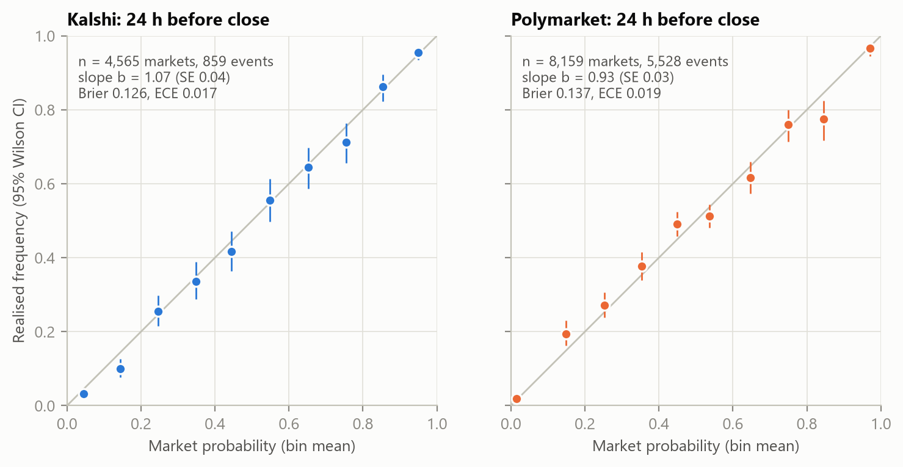
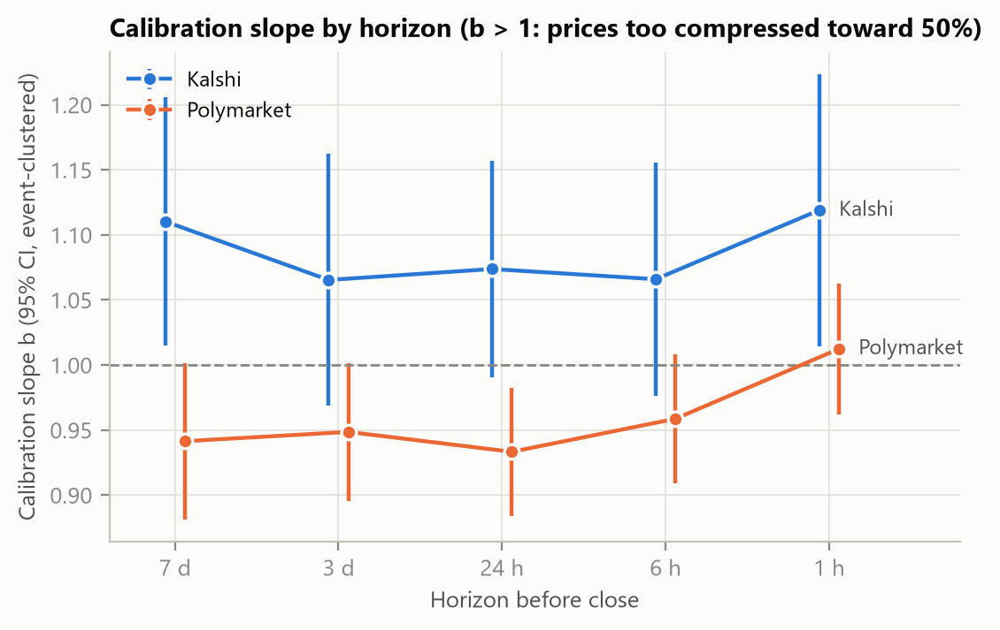
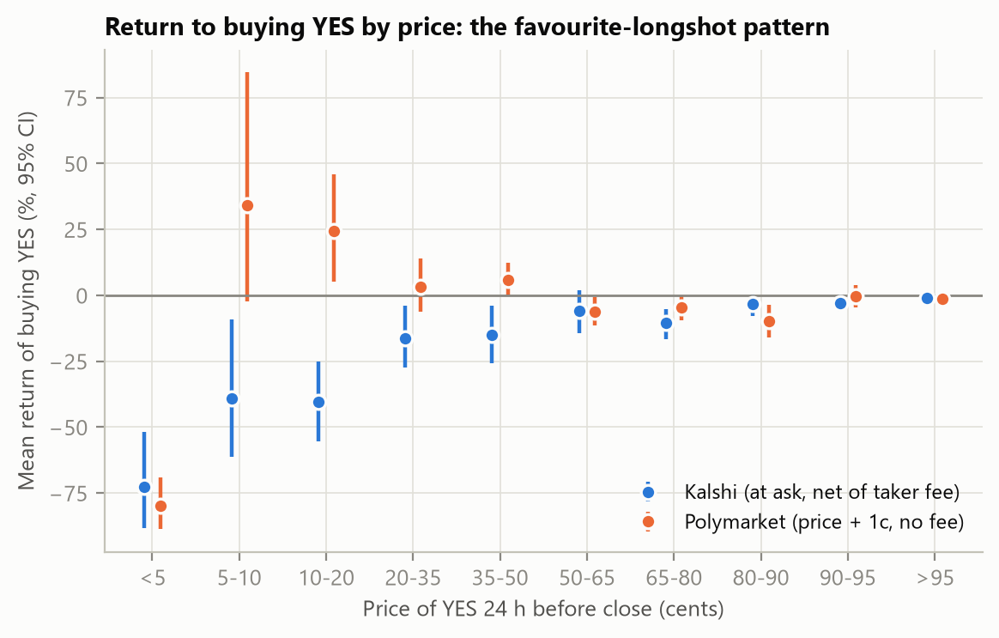
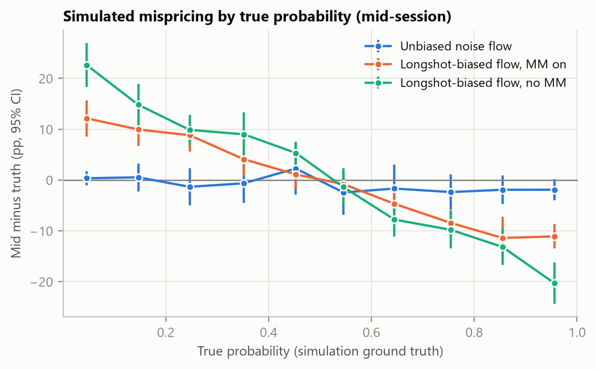
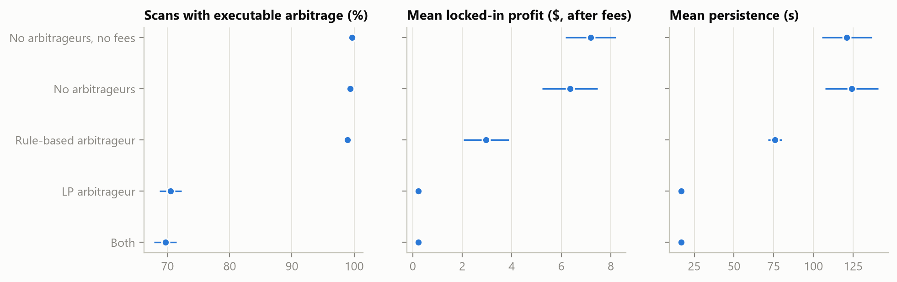
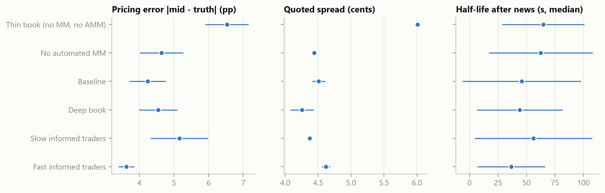
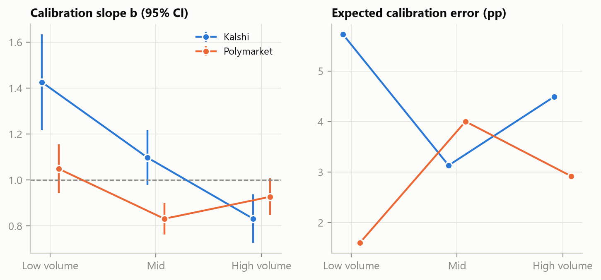
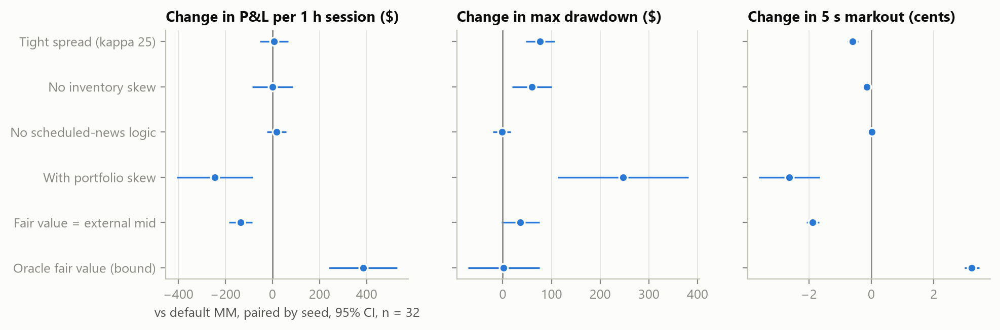

# Liquidity, Calibration and Arbitrage in Prediction Markets

*Evidence from an agent-based exchange and from Kalshi and Polymarket market data*

14 November 2026 · Working paper · Code, simulation outputs and the scripts behind every figure are in the `prediction-markets` repository (Section 10)

## Abstract

We build an open prediction-market laboratory (a limit-order-book exchange with realistic fees, ticks, latency, queue priority and collateral; a pricing engine; an automated market maker; a linear-programming arbitrage engine; and a backtester) and use it, together with 20,000 resolved Kalshi markets, 9,703 resolved Polymarket markets and a 13.9-hour tick-level capture of both venues, to study five questions. **Speed:** in Kalshi's 15-minute bitcoin and ether markets, where the relevant public information (the spot price) is observable second by second, the median market price reflects about 65% of a large spot-implied move within the same second (the resolution of our data, at which incorporation is effectively immediate) and 96% within the same minute; less than 2% of a move is still being absorbed one to two minutes later. **Calibration:** 24 hours before close, Kalshi prices are mildly compressed toward 50% (calibration slope 1.07, s.e. 0.04; 1.16 with events weighted equally) and Polymarket prices mildly too extreme (0.93, s.e. 0.03). Buying cheap contracts is very costly on Kalshi: contracts under 5 cents bought at the ask lose 72% net of fees (95% CI 52-88%). Neither venue's miscalibration survives an out-of-sample, fee-aware trading test. **Microstructure:** order flow predicts the next 30 seconds of Kalshi prices (out-of-sample R² 1.5%, 59% directional accuracy), but the predictable move (0.9 cents) is smaller than the cost of acting on it (1.6 cents); taker rules lose 0.5 cents per contract and replayed market-making and spot-informed strategies in the 15-minute crypto markets all lose 5-6 cents per contract. **Arbitrage:** across complete mutually exclusive outcome sets, executable after-fee arbitrage appears in under 1% of snapshots, is worth 1.5-2.3 cents per set and disappears in about 14 seconds; strike ladders are coherent 99.9% of the time. In simulation, the same opportunities are present in 99% of scans when nobody arbitrages, and a single LP-based arbitrageur cuts that to 70%, their life from about two minutes to 17 seconds, and pricing error by 30%. **Liquidity:** in simulation, removing market makers raises the pricing error against the known truth by 55%. Deepening the book beyond that point mostly transfers money to informed traders. In the data, the thinnest Kalshi markets are the most compressed toward 50% (slope 1.43). **Market making:** in simulation, our automated market maker earns $167 per hour (profitable in 27 of 32 seeds). Its trade-informed fair-value model drives that profit, while inventory skew and spread width change its risk rather than its returns.

## 1. Introduction

Prediction markets price binary claims on future events: a contract pays one dollar if the event happens. Read as probabilities, their prices are only as good as the trading that produces them: who supplies liquidity, how fast information arrives, whether related contracts stay coherent, and how much it costs to correct a mispricing. This paper studies those mechanics with two complementary instruments.

The first is a **simulated exchange** in which the true probability of every event is known at every instant, because it is generated as an exact martingale from latent information processes. Simulation lets us switch individual ingredients on and off (market makers, informed traders, arbitrageurs, fees, biased retail flow) and measure their effect against the truth, holding the information path fixed across experimental arms.

The second is **real market data** from Kalshi (a CFTC-regulated exchange) and Polymarket (a crypto-settled order book), obtained exclusively through their public, documented, read-only market-data endpoints under conservative rate limits. No orders were placed on any real platform. The data cover resolved markets from 2024 to November 2026 and a 13.9-hour live capture of quotes, depth and the complete Kalshi trade tape on 13 November 2026.

We ask five questions: (Q1) How quickly do prediction markets incorporate information? (Q2) Are their probabilities systematically miscalibrated? (Q3) Can market microstructure predict short-term probability changes? (Q4) How do correlated markets create arbitrage opportunities? (Q5) How does liquidity affect pricing efficiency? Throughout, we insist on realistic transaction costs: published fee formulas, one-cent ticks, latency, queue position for passive orders, full collateralisation, and the opportunity cost of capital locked until resolution.

**Summary of findings.** Prediction markets on liquid, information-rich events are fast and coherent: information is absorbed within seconds to a minute, logical constraints across related contracts are violated rarely and briefly, and short-horizon predictability is real but smaller than trading costs. Their main systematic deviation is a favourite-longshot pattern on Kalshi (cheap contracts are overpriced, most visibly once the spread and fees are counted), while Polymarket prices tilt slightly the other way. Simulation explains much of this: market makers and arbitrageurs are what keep prices coherent and close to the truth. Their absence (thin books, no cross-market arbitrage) produces exactly the large, persistent deviations that the live data rarely show.

## 2. The laboratory

**Contracts and exchange.** Binary contracts trade on integer-cent prices from 1 to 99 in a price-time-priority limit order book (one book per contract, in YES terms: a sell of YES is a purchase of NO). Order types are GTC, IOC, FOK and post-only, with self-trade prevention. Multi-outcome events are sets of binary contracts. Where the venue allows it (our Polymarket-like venue), a full set can be minted or redeemed for one dollar. Accounts are fully collateralised in integer cents: a resting order reserves its worst-case cost plus a fee bound, fills net YES against NO holdings, and settlement pays one dollar per winning contract. A randomised test of 3,000 orders, cancels, mints and redemptions with fees verifies that total cash plus fees is conserved exactly through settlement. Fees follow Kalshi's published quadratic formula, fee = roundup(0.07 × C × P × (1 − P)), applied per fill; the second venue is fee-free. Exchanges enforce per-trader message rate limits.

**Ground truth.** Each event family is driven by latent Gaussian state variables with diffusion, Poisson jumps (unscheduled news), scheduled announcements of known timing and unknown direction, and a terminal share of variance that is revealed only when the event itself happens, after trading closes. Outcomes are threshold conditions on the terminal state, so the conditional probability is an exact martingale (a Poisson mixture of normal tails). Families include single binaries, strike ladders with their bucket partition (mutually exclusive and exhaustive), and correlated pairs with a conjunction contract whose joint law is bivariate normal (computed with Owen's T function). Paths are pre-simulated from a dedicated random stream, so every experimental arm faces the identical information path.

**Traders.** Noise traders (optionally preferring the cheap side of a contract, a stylised favourite-longshot taste), informed traders (who see the truth with private noise and react to news after a delay), momentum traders, a naive fixed-spread market maker, an LMSR/LS-LMSR cost-function market maker that posts its curve into the book, and a rule-based arbitrageur compete with our strategies.

**Pricing engine.** Market-implied probabilities (mid, microprice, depth-weighted mid, multi-outcome de-vigging by proportional, power and Shin methods); Bayesian models (beta-binomial base rates, log-odds signal fusion, a Glosten-Milgrom dealer, and a jump-robust log-odds Kalman filter); logistic regression with cluster-robust standard errors; calibration models (Platt, isotonic, beta calibration, Murphy decomposition); event-driven updates (expected post-announcement price distributions); correlation models (Gaussian copula, implied correlation, Fréchet bounds, tetrachoric correlation, EWMA covariance, lead-lag); and liquidity-sensitive quoting.

**Automated market maker.** Fair value is learned only from public information: other traders' quotes and every trade print feed the log-odds Kalman filter, with larger prints treated as more informative. Quotes follow an Avellaneda-Stoikov reservation price and spread in log-odds space, widened for realised volatility, order-flow toxicity (a VPIN-style measure), approaching scheduled announcements and recent jumps; quotes are pulled shortly before scheduled news, refreshed immediately when a trade print moves fair value by half a tick, and every quote passes the risk manager. An optional portfolio mode adds a cross-market term to the inventory skew: positions in related markets shift each quote in proportion to an EWMA covariance of log-odds changes within the family. It is off by default (Section 9).

**Arbitrage engine.** For any family of related contracts we enumerate its joint outcome states and solve a linear program over all executable book levels on all venues: choose quantities to buy at asks and sell at bids, net of fees, maximising the worst-case settlement value subject to displayed size and a capital limit. The same program detects multi-outcome sum violations, ladder monotonicity violations, bucket-versus-ladder inconsistencies, conjunction bounds and cross-venue duplicates, and repairs positions left exposed when a leg fails to fill.

**Risk and execution.** Pre-trade checks (order size, price collar, position limits netted across venues, the exact worst-case settlement loss of each family including the new order, gross exposure) and a drawdown kill switch; quote reconciliation that keeps queue priority; fee-aware smart routing across venues.

**Backtesting.** Agent-based runs are reproducible from a configuration and seed and are recorded with a manifest (configuration hash, code hash, package versions). Historical replays of recorded quotes and trades use a conservative fill model: takers execute against the first recorded quote after their latency, at displayed size; passive orders join the back of the queue and fill only from later prints that trade through them, or at their price once the displayed quantity ahead has traded.

## 3. Data

All real data come from public, unauthenticated market-data endpoints, polled with token-bucket rate limits well below the published limits (one HTTP 429 at about five requests per second led us to cap Kalshi at three on average) and a generic user agent.

| Dataset | Content | Coverage |
|---|---|---|
| Kalshi resolved markets | 20,000 settled binary markets in 1,795 events from 462 series, stratified by series (at most 15 events per series, spread over time, every market of a sampled event kept), multivariate combos excluded; hourly candlesticks (best bid/ask, last price, volume) for the 30 days before close | Jan 2024 - Nov 2026; candles for 11,622 markets |
| Polymarket resolved markets | 9,703 binary markets with a clean 1/0 resolution: the ~6,000 largest by volume plus a random ~4,000 with $1k-$50k volume, recurring series capped; hourly CLOB price history | 2023 - Nov 2026 |
| Live capture | Top of book every ~4 s for ~400 active Kalshi markets and 300 Polymarket outcome tokens; full depth for the most active; the complete Kalshi trade tape (4.73 million prints, combos excluded); Coinbase BTC/ETH ticker every second | 13 Nov 2026, 05:32-19:24 UTC (13.9 h, one gap of about 40 min) |
| 15-minute crypto | Every KXBTC15M and KXETH15M market (5,784) with its strike and result, 1-minute candles; Coinbase 1-minute candles | 14 Oct - 13 Nov 2026 |

Kalshi probabilities in the resolved sample are hourly mids, kept only when both sides are quoted with a spread of at most 25 cents (the spread is retained as a liquidity measure). Polymarket probabilities are the CLOB price-history series. Inference clusters by event throughout, because the markets of a strike ladder or a multi-outcome event are strongly dependent.

## 4. Q1: How quickly do prediction markets incorporate information?

**Design.** Kalshi's 15-minute crypto contracts pay one dollar if the 60-second average of the CF Benchmarks bitcoin (or ether) index before the window's end is at least the same average before its start. The information that moves them, the spot price, is public every second. With Coinbase spot S (an index constituent), strike K, per-second volatility σ estimated before the window, and time left τ, the spot-implied probability is p* = Φ((ln S − ln K + m) / (σ√V)), where V = (τ − 60) + 20 seconds before the final minute (remaining path plus the variance of the closing average) and τ³/(3·60²) inside it, and m is the already-fixed part of the closing average. We ask how fast Kalshi's price follows p*.

**Event study (live capture, one-second resolution).** We take the largest 2% of five-second spot moves (at least 60 s apart and 3+ minutes before the close), measure the information content D as the change in p* from five seconds before to ten seconds after, and track Kalshi's one-second trade-weighted price relative to D.



| Series | Events | Share of move reflected at 0 s | at 10 s | at 30 s | at 60 s | Time to 90% |
|---|---|---|---|---|---|---|
| BTC 15-min | 86 | 64% | 85% | 68% | 76% | 85 s |
| ETH 15-min | 83 | 65% | 74% | 83% | 89% | 42 s |

About two thirds of a large spot-implied move shows up in Kalshi prices within the same second; most of the rest arrives within a minute, although the medians are noisy (the BTC curve dips between 10 and 30 seconds). The lead-lag profile (right panel) peaks at negative lags of one to two seconds: in our data, Kalshi prints move slightly *before* the recorded Coinbase change. This is a limit of our measurement rather than evidence that Kalshi leads spot. Our spot series is polled once per second and stamped on receipt, while Kalshi trades carry exchange timestamps, and Kalshi traders can watch faster venues than Coinbase. Incorporation is therefore effectively immediate at the one-second resolution of our data, and the shares in the table are, if anything, lower bounds on speed.

**Minute-level regression (30 days, 5,598 markets, 58,429 minute observations).** Regressing the change in Kalshi's mid on the contemporaneous and lagged changes in p* and on the previous minute's gap (p* − mid):

| Term | Coefficient | 95% CI (market-clustered bootstrap) |
|---|---|---|
| Δp*, same minute | 0.956 | [0.950, 0.961] |
| Δp*, one minute earlier | 0.012 | [0.008, 0.016] |
| Δp*, two minutes earlier | 0.004 | [0.000, 0.007] |
| Gap at t−1 | 0.220 | [0.209, 0.230] |

R² is 0.88. Ninety-six percent of a spot-implied move is incorporated within the minute in which it happens and less than 2% more over the following two minutes. Kalshi also closes 22% of any remaining gap to p* per minute; because p* is itself an imperfect model, part of that gap is model error rather than mispricing. Five minutes before the close, Kalshi's own mid is a slightly better forecast than p* (Brier 0.123 versus 0.126 over 5,598 markets): the market knows the actual index and its microstructure better than our proxy does.

**Simulation.** With the true probability known, the median time for the mid to close half of the gap after a large news jump is 46 s in the baseline market, 65 s in a thin market and 37 s when informed traders are fast and numerous; with eight paired seeds these half-life differences are not statistically significant, while the effects on average pricing error are (Section 8).

## 5. Q2: Are probabilities systematically miscalibrated?



We regress outcomes on the log-odds of the price, y ~ Bernoulli(σ(a + b·logit p)). A slope b above one means prices are too compressed toward 50% (longshots overpriced, favourites underpriced); below one, too extreme. Standard errors are clustered by event.

| Venue | Horizon | Markets | Events | Brier | ECE | Slope b (s.e.) | b, events weighted equally |
|---|---|---|---|---|---|---|---|
| Kalshi | 7 days | 2,906 | 511 | 0.123 | 0.033 | 1.11 (0.05) | 1.17 (0.06) |
| Kalshi | 24 hours | 4,565 | 859 | 0.127 | 0.017 | 1.07 (0.04) | 1.16 (0.05) |
| Kalshi | 1 hour | 2,825 | 736 | 0.115 | 0.020 | 1.12 (0.05) | 1.17 (0.06) |
| Polymarket | 7 days | 4,918 | 2,799 | 0.121 | 0.022 | 0.94 (0.03) | 0.87 (0.04) |
| Polymarket | 24 hours | 8,159 | 5,528 | 0.137 | 0.019 | 0.93 (0.03) | 0.89 (0.03) |
| Polymarket | 1 hour | 8,835 | 6,103 | 0.102 | 0.010 | 1.01 (0.03) | 0.99 (0.03) |



Both venues are well calibrated in absolute terms (expected calibration error 1-3 percentage points), but in opposite directions: Kalshi prices are mildly compressed at every horizon, and more so when each event counts once (b ≈ 1.16), while Polymarket prices are mildly too extreme from 6 hours to 7 days out. By category, sports markets are too extreme on both venues (Kalshi b = 0.78, s.e. 0.10; Polymarket 0.81, s.e. 0.04), while financial, crypto and political markets are compressed (Kalshi financials 1.18; Polymarket politics and macro 1.08, crypto 1.14).

**Returns by price.** Calibration slopes understate how much the favourite-longshot pattern costs a trader, because cheap contracts also carry the largest spread and fee per dollar.



On Kalshi, buying YES at the ask 24 hours before close (net of the taker fee) returns −72% for contracts under 5 cents (95% CI −88% to −52%), about −40% from 5 to 20 cents, −15% from 20 to 50 cents and −1% to −3% above 80 cents. The losses decline monotonically with price: the classic favourite-longshot shape. Polymarket shows the opposite between 10 and 20 cents (+25%, CI +5% to +46%), consistent with its slope below one. That estimate assumes a one-cent half-spread and no fee, and rests on a noisier price series.

**Is it exploitable?** We fit Platt and isotonic recalibration maps on the earlier half of each venue's markets (by close date) and test them on the later half. Recalibration does not improve out-of-sample Brier scores (Kalshi 0.128 → 0.129-0.130; Polymarket 0.160 → 0.160). A rule that buys whenever the recalibrated probability beats the executable cost by two cents loses money on Kalshi (−5.6 cents per contract, CI −12.1 to +0.9, Platt; −4.8 cents, CI −8.0 to −1.3, isotonic) and earns nothing distinguishable from zero on Polymarket (+0.4 cents, CI −2.0 to +2.9). The miscalibration is real on average but not stable or large enough to trade after costs.

**A caution from simulation.** In the simulator we can separate bias from noise. When retail flow is unbiased, mid-session prices are unbiased around the truth (slope of price log-odds on true log-odds 1.01, s.e. 0.02), yet the usual outcome-based calibration slope is only 0.64 (s.e. 0.08): idiosyncratic pricing noise attenuates the regression, so an unbiased but noisy market looks overconfident. Outcome-based slopes therefore mix two forces. Noise pushes them below one and favourite-longshot bias pushes them above one. Polymarket's sub-unit slopes may partly reflect noisier price measurement, and Kalshi's compression may be larger than measured. When noise traders prefer longshots, the simulated market reproduces the favourite-longshot pattern: with our market maker active, longshots are overpriced by 11 percentage points and favourites underpriced by 11 points against the truth. Without the market maker the distortion roughly doubles (20 and 19 points), and with only one informed trader prices barely track the truth (35-36 points).



## 6. Q3: Can microstructure predict short-term probability changes?

**Real data.** For the 72 most active Kalshi markets outside the 15-minute crypto contracts (151,036 five-second observations), we predict the mid change over the next 30 seconds from level-one imbalance, signed trade flow over the previous 30 seconds, microprice minus mid and the previous 30-second change, fitting on the first 60% of the capture and testing on the rest.

| Out-of-sample statistic | Value |
|---|---|
| R² | 1.5% |
| Directional accuracy (when the mid moves) | 59% |
| Share of intervals in which the mid moves at all | 35% |
| Mean absolute 30 s move | 0.90 cents |
| Mean cost of crossing (half spread + taker fee) | 1.63 cents |
| Forecasts larger than that cost | 29 of 60,421 |
| Edge of a taker acting on them | −0.47 cents per contract (CI −0.60 to −0.28) |

Signed order flow is the strongest predictor (test-set correlation 0.11), followed by book imbalance (0.06). The signal is statistically real but economically too small: the typical predictable move is about half the cost of trading on it.

**Replay backtests.** We replayed three strategies through every 15-minute BTC and ETH window in the capture (46 windows with complete data) with 0.5 s latency, queue-position fills, Kalshi fees and settlement at the official result.

| Strategy | Contracts | P&L | Per contract | Windows profitable | t-stat |
|---|---|---|---|---|---|
| Join the best bid and ask (10 lots) | 1,260 | −$70 | −5.5 c | 20% | −2.4 |
| Quote around the spot-implied p* ± 2 c | 26,316 | −$1,296 | −4.9 c | 22% | −4.0 |
| Take when p* beats the quote by fee + 3 c | 4,170 | −$226 | −5.4 c | 26% | −1.2 |

All three lose. Passive orders are filled mostly when informed traders are on the other side (adverse selection), and a spot model available at retail latency is not better than the market's own price (Section 4).

**Simulation.** With eight seeds, imbalance and flow features explain 0.6% of the next 30-second change out of sample (54.5% directional accuracy) and almost never exceed the half-spread (0.2% of observations), even though the true mispricing, which only informed traders see, correlates 0.34 with the subsequent move. Public microstructure captures only a sliver of what informed traders know.

## 7. Q4: How do correlated markets create arbitrage opportunities?

Related contracts must satisfy logical constraints: mutually exclusive outcomes cannot sum to more than one (sell-all arbitrage), an exhaustive set cannot cost less than one (buy-all arbitrage), the probability of exceeding a higher strike cannot exceed that of a lower strike, and a conjunction lies within the Fréchet bounds of its legs. Our LP engine checks all of these at once, after fees, against displayed depth.

**Live data.** We tested every snapshot of the 13.9-hour capture. Two corrections proved essential and are worth stating because they turn spurious arbitrage into real measurement. (i) Many Kalshi events contain "above K" contracts on different underlyings (two teams' spreads, several players' props); only contracts on one underlying with a strike in the ticker form a ladder. (ii) A buy-all test requires the complete outcome set, which we verified for each event against the exchange's own event listing; quotes were used only while the market was being polled and not in its final minute, and empty book sides were treated as missing.

| Test | Events | Snapshots | With arbitrage | Mean edge per set | Median duration |
|---|---|---|---|---|---|
| Kalshi buy-all (verified complete sets) | 35 | 21,297 | 0.93% | 1.5 c | 13.5 s |
| Kalshi sell-all (mutually exclusive sets) | 36 | 21,686 | 0.64% | 2.3 c | 14.2 s |
| Kalshi strike ladders | 27 | 11,007 | 0.07% | 2.3 c | n/a |
| Polymarket sell-all (neg-risk events) | 4 | 20,967 | 24.0% | 0.55 c | 58 s |

Kalshi's related markets are almost always coherent. Violations are worth a cent or two per set, sized in tens of contracts, and gone within about three snapshots. Our edges use the exact fee rate. Kalshi rounds fees up to the next cent per order, which for small orders adds up to a cent per leg and would erase most of these.

The Polymarket violations are different: a persistent overround of about half a cent on the bid side of multi-outcome events, for example a median episode of 18 minutes in the five-outcome market on the December Federal Reserve decision. Every one of these snapshots includes a near-settled leg (bid at least 97 cents or at most 3 cents). Selling every outcome there means buying all the NO contracts for about four dollars to collect half a cent at resolution weeks later: roughly 1.5% annualised, below the Treasury-bill rate. The cost of capital, not inattention, keeps it open.

**Simulation.** The live picture is what arbitrage looks like once arbitrageurs are present. In the simulator (eight paired seeds, one-hour sessions, a read-only LP monitor scanning every five seconds):



| Arm | Scans with arbitrage | Mean locked-in profit | Mean persistence | Pricing error (pp) |
|---|---|---|---|---|
| No arbitrageurs | 99.3% | $6.35 | 124 s | 5.9 |
| Rule-based arbitrageur | 98.9% | $2.96 | 76 s | 4.8 |
| LP arbitrageur | 70.5% | $0.23 | 17 s | 4.1 |
| Both | 69.7% | $0.22 | 17 s | 4.2 |

Without arbitrageurs, executable arbitrage across the ladder, buckets, conjunctions and duplicate listings exists almost all the time and persists for two minutes, because each contract's book is supplied by market makers who quote it in isolation. A rule-based arbitrageur that only checks simple sums halves the profit but barely changes how often violations occur. An optimising arbitrageur that solves the joint problem reduces incidence by 29 percentage points (paired 95% CI ±2), profit per opportunity by 96% and persistence by 107 s, earns $334 per hour (CI ±138), and lowers the average pricing error against the truth by 1.8 percentage points (CI ±0.4). Arbitrage across related markets is a channel of price discovery: it propagates information that arrives in one contract to its logical relatives. Removing fees raises incidence by only 0.3 points.

## 8. Q5: How does liquidity affect pricing efficiency?

**Simulation.** We vary who supplies liquidity, with eight paired seeds per arm.



| Arm (vs baseline, paired) | Pricing error | Quoted spread | Informed traders' P&L |
|---|---|---|---|
| Thin book (no automated market makers) | +2.3 pp (CI ±0.6; 8/8 seeds) | +1.5 c | −$77 (n.s.) |
| Without our market maker | +0.4 pp (CI ±0.3) | −0.1 c (n.s.) | −$57 (n.s.) |
| Deep book (larger quotes) | +0.3 pp (n.s.) | −0.3 c | +$606 (CI ±613, p = 0.05) |
| Slow informed traders | +0.9 pp (CI ±0.6) | −0.1 c | +$285 (n.s.) |
| Fast informed traders | −0.6 pp (CI ±0.5) | +0.1 c (n.s.) | +$6 (n.s.) |

Liquidity matters a great deal up to a point. Going from a thin book to a market with automated liquidity providers cuts the average gap between the mid and the true probability from 6.5 to 4.2 percentage points (−35%) and the spread from 6.0 to 4.5 cents. Beyond that point, larger quotes add little efficiency and mostly enlarge the trades informed traders can make against them. The speed of informed trading is as important as depth.

**Real data.** Within venues, market liquidity lines up with calibration in the way simulation suggests, though not monotonically.



| Venue, split | Low tercile | Middle | High tercile |
|---|---|---|---|
| Kalshi, volume: slope b (s.e.) | 1.43 (0.11) | 1.10 (0.06) | 0.83 (0.05) |
| Kalshi, volume: ECE | 5.7 pp | 3.1 pp | 4.5 pp |
| Kalshi, quoted spread (1 c / 4 c / 10 c): slope b | 1.04 (0.07) | 1.06 (0.06) | 1.13 (0.06) |
| Kalshi, quoted spread: ECE | 2.2 pp | 2.4 pp | 3.2 pp |
| Polymarket, volume: slope b | 1.05 (0.05) | 0.83 (0.04) | 0.93 (0.04) |

The thinnest Kalshi markets are strongly compressed toward 50%: their prices do not move far enough from the opening line, as if information is not fully incorporated. Wide-spread markets are worse calibrated than tight ones. The most heavily traded Kalshi markets lean the other way (b = 0.83), partly because they are disproportionately sports contracts, which are too extreme on both venues.

## 9. Market-maker design: what matters

We test each variant of our market maker on 32 seeds and compare it with the default on the same seed. Every arm sees the same information path, so the differences are paired. The default earns +$167 per one-hour session (95% CI ±$59; profitable in 27 of 32 seeds), while the naive fixed-spread maker in the same markets loses $39. Its parameters were set in an informal sweep on separate tuning seeds. One later change, switching off the portfolio skew, was made after seeing the first eight evaluation seeds, so for that arm we also report the 24 seeds the decision never saw.

- **The fair-value model matters most.** Replacing the trade-informed Kalman fair value with the external mid lowers P&L by $135 (CI ±49; worse in 27 of 32 seeds) and the five-second markout by 1.9 cents (worse in all 32). Perfect knowledge of the truth, an upper bound, adds $385 (CI ±145; better in 28 of 32) and 3.2 cents of markout. The gap between the default and that bound is more than twice the default's own profit.
- **Portfolio inventory skew hurts.** Turning it on lowers P&L by $245 (CI ±161; worse in 21 of 32), nearly triples the maximum drawdown (from $128 to $375) and turns the five-second markout negative. On the 24 seeds the decision never saw, the loss is $282 (CI ±189, p = 0.005). A likely cause is that the cross-market covariances it relies on are estimated from sparse, noisy price changes.
- **Inventory skew and spread width change risk, not profit.** Without the per-market inventory skew, mean P&L is unchanged (−$0.3, CI ±86), but its seed-to-seed standard deviation rises from $163 to $265 and the maximum drawdown rises by $60 (CI ±41; worse in 23 of 32). Quoting tighter (κ = 25 instead of 8) trades 63% more volume at 1.4 cents less spread capture per contract. P&L is unchanged (+$7, CI ±60) and the drawdown rises by $77 (CI ±29; worse in 29 of 32).
- **The scheduled-news rules show no measurable benefit.** Without the rules that pull and widen quotes around announcements, P&L is $18 higher (CI ±41, p = 0.37). An earlier eight-seed estimate, a $240 loss measured with the portfolio skew on, does not carry over.

Among the ingredients that help, only the fair-value model raises expected profit. Inventory skew and wider quotes lower risk without raising returns.



## 10. Reproducibility

The commands below regenerate every result (Python 3.12; numpy, scipy, pandas, matplotlib, requests; markdown-it-py to build the paper). Each simulation experiment writes `runs/<experiment>_<tag>/` (tag `main` unless given) with every (arm, seed) result and a manifest containing the configuration, seeds, code hash and package versions; interrupted suites resume. Runs are deterministic given the seed. The 32-seed market-maker suite was run a day after the first suite, after code changes elsewhere in the repository, and it reproduced exactly the 16 runs the two suites share. Simulation results need no external data. The raw market data (about 2.8 GB) are not distributed with the code: the collectors rebuild the resolved-market datasets from the venues' public endpoints, but the live capture of 13 November 2026 was a one-time recording and cannot be re-collected.

```
python collect/live_snapshots.py --hours 14          # live capture (read-only, rate-limited)
python collect/hist/k_scan.py                        # Kalshi: index of settled events
python collect/hist/k_sample.py                      # Kalshi: stratified market sample
python collect/hist/k_candles.py                     # Kalshi: hourly candles
python collect/hist/pm_collect.py cands|prices       # Polymarket: sample and price histories
python collect/hist/crypto15m.py coinbase|markets|candles
python collect/event_counts.py                       # outcome counts for the arbitrage study
python -m research.sim_experiments e1 e2 e3 e4 --seeds 8 --T 3600
python -m research.sim_experiments e5 --seeds 32 --T 3600 --tag seeds32
python -m research.sim_analysis ; python -m research.sim_contrasts
python -m research.real_calibration ; python -m research.real_speed
python -m research.real_microstructure ; python -m research.real_arbitrage
python -m pytest tests
python paper/build.py                                # paper.html and paper.pdf
```

## 11. Limitations

- **Short live window.** The tick-level evidence comes from one 13.9-hour session (a Friday, overnight into the US morning) and is dominated by crypto and sports markets. Arbitrage incidence and microstructure predictability may differ around major events.
- **Proxy information and timestamps.** Coinbase spot, polled once per second and stamped on receipt, stands in for the CF Benchmarks index in the speed study. Sub-second lead-lag cannot be resolved, and part of the p*-versus-market gap reflects the proxy rather than mispricing.
- **Sampling.** The Kalshi sample is stratified by series and weighted toward 2025-2026, when most series exist; the Polymarket sample over-represents high-volume markets by design. Prices near close include markets whose outcome was already effectively known.
- **Price measurement.** Polymarket price histories are not two-sided quotes; noisier prices attenuate calibration slopes (Section 5).
- **Simulation is a model.** Agent behaviour is stylised; conclusions are about mechanisms (what changes when an ingredient is removed), not about the level of real-world profits. Most experiments use eight seeds per arm. That is enough for pricing error and arbitrage incidence but not for P&L: at eight seeds the market-maker ablations suggested effects that 32 seeds did not confirm, so P&L differences in the eight-seed experiments are indicative only. The market maker's default parameters come from an informal sweep that is not part of the reproducible pipeline.
- **Execution assumptions.** Replays treat the recorded market as unaffected by our orders and use top-of-book quotes sampled every few seconds; real queue dynamics are finer than our model.

## 12. Conclusion

On liquid, information-rich contracts, prediction markets behave like efficient markets with frictions. Public information is absorbed within seconds to a minute. Related contracts stay coherent apart from brief, small violations. Short-horizon predictability exists but is smaller than the cost of trading on it. The main systematic deviation, a favourite-longshot pattern on Kalshi, is real on average but does not survive an out-of-sample, fee-aware trading test. Liquidity improves pricing up to a point, beyond which deeper books mostly pay informed traders; in the data, the thinnest Kalshi markets are the furthest from calibrated.

The simulator explains these patterns. Market makers and an optimising arbitrageur are what keep prices close to the truth and coherent across contracts, and removing them produces the large, persistent deviations that the live data rarely show. For a market maker in our simulations, profit comes from a better estimate of fair value learned from trades; inventory controls and spread width decide how much risk is taken to earn it.

## References

- Avellaneda, M. and Stoikov, S. (2008). High-frequency trading in a limit order book. *Quantitative Finance* 8(3), 217-224.
- Chen, Y. and Pennock, D. M. (2007). A utility framework for bounded-loss market makers. *Proceedings of UAI*.
- Cont, R., Kukanov, A. and Stoikov, S. (2014). The price impact of order book events. *Journal of Financial Econometrics* 12(1), 47-88.
- Easley, D., López de Prado, M. M. and O'Hara, M. (2012). Flow toxicity and liquidity in a high-frequency world. *Review of Financial Studies* 25(5), 1457-1493.
- Glosten, L. R. and Milgrom, P. R. (1985). Bid, ask and transaction prices in a specialist market with heterogeneously informed traders. *Journal of Financial Economics* 14(1), 71-100.
- Guéant, O., Lehalle, C.-A. and Fernandez-Tapia, J. (2013). Dealing with the inventory risk: a solution to the market making problem. *Mathematics and Financial Economics* 7(4), 477-507.
- Hanson, R. (2003). Combinatorial information market design. *Information Systems Frontiers* 5(1), 107-119.
- Hanson, R. (2007). Logarithmic market scoring rules for modular combinatorial information aggregation. *Journal of Prediction Markets* 1(1), 3-15.
- Hasbrouck, J. (1991). Measuring the information content of stock trades. *Journal of Finance* 46(1), 179-207.
- Kull, M., Silva Filho, T. and Flach, P. (2017). Beta calibration: a well-founded and easily implemented improvement on logistic calibration for binary classifiers. *Proceedings of AISTATS*.
- Kyle, A. S. (1985). Continuous auctions and insider trading. *Econometrica* 53(6), 1315-1335.
- Manski, C. F. (2006). Interpreting the predictions of prediction markets. *Economics Letters* 91(3), 425-429.
- Murphy, A. H. (1973). A new vector partition of the probability score. *Journal of Applied Meteorology* 12(4), 595-600.
- Othman, A., Pennock, D. M., Reeves, D. M. and Sandholm, T. (2013). A practical liquidity-sensitive automated market maker. *ACM Transactions on Economics and Computation* 1(3).
- Owen, D. B. (1956). Tables for computing bivariate normal probabilities. *Annals of Mathematical Statistics* 27(4), 1075-1090.
- Page, L. and Clemen, R. T. (2013). Do prediction markets produce well-calibrated probability forecasts? *Economic Journal* 123(568), 491-513.
- Platt, J. (1999). Probabilistic outputs for support vector machines and comparisons to regularized likelihood methods. In *Advances in Large Margin Classifiers*, MIT Press.
- Shin, H. S. (1993). Measuring the incidence of insider trading in a market for state-contingent claims. *Economic Journal* 103(420), 1141-1153.
- Snowberg, E. and Wolfers, J. (2010). Explaining the favorite-long shot bias: Is it risk-love or misperceptions? *Journal of Political Economy* 118(4), 723-746.
- Thaler, R. H. and Ziemba, W. T. (1988). Anomalies: Parimutuel betting markets: racetracks and lotteries. *Journal of Economic Perspectives* 2(2), 161-174.
- Wolfers, J. and Zitzewitz, E. (2004). Prediction markets. *Journal of Economic Perspectives* 18(2), 107-126.
- Zadrozny, B. and Elkan, C. (2002). Transforming classifier scores into accurate multiclass probability estimates. *Proceedings of KDD*.

*Data sources: Kalshi and Polymarket public market-data APIs and Coinbase Exchange public market data, accessed read-only on 13-14 November 2026. Fee formula: Kalshi published fee schedule (series metadata fee_type "quadratic"). No orders were placed on any real venue.*
